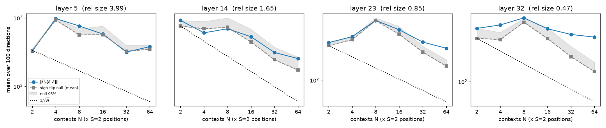

# Фаза 1. H1: усреднённый гессиан ≈ 0?

**Вердикт: H1 отвергнута** (Qwen3-4B, и независимо на Qwen3-0.6B). Ни на одном слое не выполнены
одновременно все три условия H1. На слоях 65% и 90% средний гессиан надёжно отличен от нуля.
На 15% и 40% он статистически неотличим от нулевой модели при N = 64, но и там
квадратичный член не мал: несмещённая оценка его размера порядка 0.4–0.5 от линейного (медиана).

Код: `scripts/phase1.py`, `scripts/phase1_debias.py`, `scripts/plot_phase1.py`. Конфиги:
`configs/phase1_4b.yaml`, `configs/phase1_0.6b.yaml`. Сид 0. Версия кода записана в `phase1.json`
(поле `git`: HEAD репозитория + хеш содержимого `src/scripts/configs`, потому что `experiments/`
ещё не закоммичена).

## Постановка (как в промпте; агрегирование как в `jlens/fitting.py`)

* `f_{c,t}(x) = Σ_{t'=t}^{T-2} h_final[t'](h_ℓ[t] := x)`: возмущается только позиция t, цели
  суммируются по t' ≥ t в пределах валидных позиций [16, T−2]. Это та же редукция, что у оценщика J в репозитории:
  сумма котангенсов по целевым позициям, затем среднее по позициям-источникам.
* `H_{c,t}[δ,δ]` считается вложенным `torch.func.jvp` по хвосту сети от блока ℓ+1. Префикс < t
  не пересчитывается: K/V для позиций < t берутся из чистого прохода. Веса fp32, матмулы TF32.
* Слои {15, 40, 65, 90}% от 36 = **{5, 14, 23, 32}**. 100 направлений `δ = h − μ_ℓ`: случайные
  (последовательность, позиция ≥ 16) из held-out WikiText-103 validation. μ_ℓ считается по 100 последовательностям подгонки (train).
* Контексты: 64 последовательности из train, не пересекающиеся с корпусом подгонки, по S = 2 случайные позиции в каждой.
  Блоки N = 16 → 32 → 64. Ранняя остановка слоя: z ≥ 3 и |‖H̄_N‖/‖H̄_{N/2}‖ − 1| ≤ 0.15.
* Нулевая модель: 200 случайных наборов знаков ε_m ∈ {±1} на выборку (c,t), `‖(1/M) Σ ε_m X_m‖`.
* Линза J̄: готовая линза Neuronpedia для Qwen3-4B (`neuronpedia/jacobian-lens`,
  `qwen3-4b/jlens/Salesforce-wikitext/Qwen3-4B_jacobian_lens.pt`). Подогнана кодом Anthropic
  на WikiText-103 train: 479 последовательностей × 128 токенов, bf16, ранняя остановка по
  относительному изменению среднего < 0.002. Для 0.6B линза подогнана нами: 100 × 128, `jlens.fit`, bf16.

## Проверки корректности (Qwen3-0.6B, fp64; `results/phase0/qwen3-0.6b/checks.json`)

| проверка | результат |
|---|---|
| функциональный стек Qwen3 против HF forward | макс. отн. ошибка 1.8e-7 (потолок задаёт HF eager-softmax в fp32) |
| переиспользование префикса против полного пересчёта (f, Ju, H[u,v]) | ≤ 6e-14 |
| вложенный forward-mode H[u,u] против центральных конечных разностей | лучшая отн. ошибка ≤ 3.1e-6 на всех 12 (слой, позиция); порог 1e-3 |
| TF32/fp32 против fp64 для H[u,u] | 1.2e-3 – 2.9e-3 отн. ошибки |

## Результаты, Qwen3-4B (N = 64, M = 128 выборок (c,t))

| слой | ‖H̄_N[δ,δ]‖ | нулевая модель: среднее / 95% | z = ‖H̄‖/нулевая | доля δ выше 95% нулевой | ‖H̄_64‖/‖H̄_32‖ | отн. размер ‖½H̄‖/‖J̄δ‖ (среднее / медиана) | **несмещённый** отн. размер (среднее / медиана) | средний по контекстам ‖½H_c‖/‖J̄δ‖ | пересечение top-10 V1 и V2 |
|---|---|---|---|---|---|---|---|---|---|
| 5 (15%) | 380 | 347 / 398 | 1.09 | 0.03 | 1.20 | 3.99 / 2.48 | 1.33 / 0.54 | 17.2 | 0.18 |
| 14 (40%) | 342 | 263 / 354 | 1.30 | 0.18 | 0.87 | 1.65 / 1.07 | 0.82 / 0.37 | 10.7 | 0.26 |
| 23 (65%) | 267 | 154 / 188 | 1.74 | 0.72 | 0.83 | 0.85 / 0.79 | 0.64 / 0.62 | 3.6 | 0.56 |
| 32 (90%) | 338 | 132 / 170 | 2.57 | 0.98 | 0.93 | 0.47 / 0.45 | 0.43 / 0.41 | 1.5 | 0.69 |

Несмещённая оценка: `‖E H‖² ≈ (‖Σ_m X_m‖² − Σ_m ‖X_m‖²) / (M(M−1))` для каждого направления, с обрезкой снизу нулём.
Для этой оценки положительный квадрат норм получился у 61% (слой 5), 74% (14), 91% (23) и 100% (32) направлений.
На ранних слоях часть направлений совместима с нулевым средним.

Кривая сходимости (`qwen3-4b/convergence.png`). На слоях 23 и 32 норма выходит на плато, а нулевая модель
продолжает падать: ‖H̄‖/нулевая растёт с 1.0 до 1.7 и с 1.3 до 2.6. На слоях 5 и 14
норма идёт вместе с нулевой моделью. До N ≈ 8 обе кривые неровные: выборки H_{c,t} с тяжёлыми хвостами,
отдельные контексты дают выбросы, и закон 1/√N начинает выполняться только с N ≈ 16.

Проверка критериев H1 (`phase1.json → verdict_per_layer`):

| слой | неотличимо от нулевой модели | отн. размер < 5% | top-10 > 0.95 |
|---|---|---|---|
| 5 | да | нет | нет |
| 14 | да | нет | нет |
| 23 | **нет** | нет | нет |
| 32 | **нет** | нет | нет |

Ни один слой не прошёл больше одного критерия, поэтому **H1 отвергнута** и по правилам промпта начата Фаза 2.

## Qwen3-0.6B (отладочный прогон, тот же протокол)

| слой | z | доля δ выше 95% нулевой | отношение | несмещённый отн. размер (медиана) | top-10 |
|---|---|---|---|---|---|
| 4 | 1.24 | 0.67 | 0.66 | 0.81 | 0.33 |
| 11 | 2.15 | 1.00 | 0.91 | 0.83 | 0.44 |
| 18 | 2.55 | 1.00 | 0.95 | 0.60 | 0.56 |
| 25 | 3.41 (закрыт при N = 32) | 1.00 | 0.99 | 0.31 | 0.69 |

На маленькой модели картина та же, и среднее отлично от нуля уже на слоях 40%+.

## Интерпретация и оговорки

1. **Кривизна гасится частично.** Средняя по контекстам норма отдельных `½H_{c,t}[δ,δ]`
   в 1.5–17 раз больше ‖J̄δ‖. Усреднение уменьшает её в 3–30 раз, но до нуля не доводит:
   на слоях 65–90% остаётся систематическая часть, примерно 0.4–0.6 от линейного члена.
2. **δ — не малое возмущение.** δ = h − μ здесь полная активация без среднего, поэтому квадратичный член
   сравним с линейным или больше его. Ряд Тейлора вокруг μ на таком радиусе может не
   сходиться, и члены 3-го порядка тоже могут быть велики. Поэтому вывод «H̄ ≠ 0» ещё не означает, что
   квадратичная линза будет точнее. Это проверяет Фаза 2.
3. Ранняя остановка ни на одном слое 4B не сработала: z ≥ 3 не достигнут, так как при N ≤ 64 шум
   всё ещё того же порядка, что и сигнал. Все слои досчитаны до максимума N = 64, урезаний не было.
4. Замер пропускной способности занизил время в ~2.5 раза. В замерочном контексте позиции были
   t = 103 и 108 (хвост ~22 токена против ~58 в среднем). Фактическое время Фазы 1 на 4B — 1342 с GPU (0.37 ч)
   против прогноза 0.14 ч, в пределах бюджета 1.5 ч.
