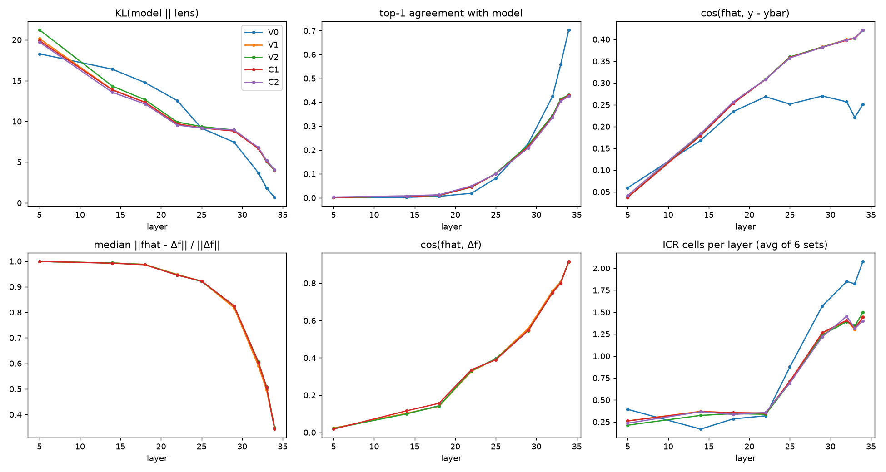
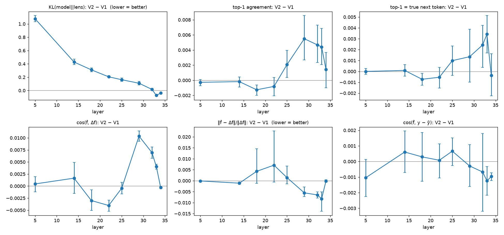

# Фаза 2. H2: точнее ли квадратичная линза? Что с ICR?

**Вердикт по H2 (Qwen3-4B, k = 16, N = 64, S = 2): не подтверждена.** Квадратичная линза V2 в
подпространстве U_J по точности практически совпадает с контролем V1. Небольшие улучшения,
статистически значимые, но малые по величине (сотые доли), есть **только на поздних слоях (29–33)**,
а не на ранних, как предполагала H2. На ранних слоях V2 даже хуже по KL. ICR и SHL почти не меняются, и
эффекта «подтягивания к следующему токену в ущерб промежуточным концептам» не видно.
Главное ограничение: U_J (k = 16) захватывает всего **3–4% ‖δ‖²**. Поэтому квадратичный член, крупный
в полном пространстве (Фаза 1: 0.4–0.6 от линейного на поздних слоях), в подпространстве почти
пропадает.

Код: `scripts/phase2.py`, `scripts/report_phase2.py`, `scripts/plot_phase2_diff.py`. Конфиг:
`configs/phase2_4b.yaml`. Сид 0. Версия кода записана в `qwen3-4b/meta_k16.json`. Сырые данные лежат в `qwen3-4b/eval_raw_k16.pt`
и `deltaf_raw_k16.pt`, средние H̄ и базис U — в `../artifacts/qwen3-4b/phase2_U_Hbar_k16.pt`.

## Постановка

* **Слои** (из 36): 15% → 5, {40, 50, 60, 70, 80, 90}% → {14, 18, 22, 25, 29, 32}, последние три
  слоя, для которых есть линза, → {32, 33, 34}. Итого **{5, 14, 18, 22, 25, 29, 32, 33, 34}** (90% совпадает с L−4).
* **U_J.** Берём 4000 активаций корпуса подгонки (100 × 40 позиций), δ = h − μ. Для каждой выбираем 25 токенов с
  наибольшим J-lens-счётом ⟨δ, w_v⟩, где w_v = J̄ᵀ(g ⊙ W_U[v]) и g — gain финальной нормы (это ранжирование V1).
  Затем δ проецируется методом наименьших квадратов на span{w_v}: разреженного неотрицательного разложения в репозитории нет.
  U_J — top-16 главных направлений этих проекций.
  *Альтернатива, записываю её, но не запускал:* сумма проекций на нормированные w_v без ортогонализации или NNLS.
* **H̄[u_i, u_j]** для i ≤ j (136 пар) считается вложенным forward-mode AD так же, как в Фазе 1. Контексты и
  позиции те же, что в Фазе 1 (64 × 2).
* **Варианты.** V0 = J̄h; V1 = J̄δ; V2 = J̄δ + ½Σ z_i z_j H̄[u_i,u_j], z = Uᵀδ;
  C1 = V1 + гауссов вектор нормы ‖½H̄_k[δ,δ]‖; C2 = V1 + ½H̄_k с другого слоя, отмасштабированный до нормы
  собственного члена. Пары слоёв для C2: 5→25, 14→29, 18→32, 22→33, 25→34, 29→5, 32→14, 33→18, 34→22.
* **Held-out:** 100 последовательностей WikiText-103 validation, позиции [16, T−2], bf16.
  **lens-eval:** шесть наборов из `data/evaluations/` (551 промпт).
* **Точность.** `cos(f̂, y−ȳ)` и `‖f̂−y‖/‖y‖`, где y[t] = Σ_{t'≥t} h_final[t'] — агрегирование по определению
  из промпта. Дополнительно **Δf** — точный отклик на абляцию к среднему: Δf = f_{c,t}(h) − f_{c,t}(μ). Именно его
  приближает f̂(δ). Считается в fp32 на 8 позициях × 100 последовательностях × 9 слоях.
  *Почему понадобился Δf:* у `‖f̂ − y‖/‖y‖` значение ≈ 0.97–1.00 для всех вариантов. Сумма ~60 будущих финальных
  состояний в основном не зависит от h_t, и метрика почти ничего не различает.
* **KL**(p_model ‖ p_lens) и **top-1** против модели на тех же позициях.
* **SHL** по Alibaba (ур. 21): длина серии слоёв сверху, у которых top-1 равен истинному следующему токену.
  «С последним слоем» — серия начинается с выхода модели (блок 35), «без» — с верхнего слоя линзы (34).
  Серия идёт только по подряд идущим индексам среди оцененных слоёв, поэтому в Фазе 2
  SHL_with ≤ 4 (35, 34, 33, 32).
* **ICR** считается по всем позициям промпта. *Сырой* — число ячеек (слой, позиция), в которых top-10 содержит
  первый токен концепта (формы «w» и « w»). *Нормированный* — доля концептов промпта, попавших
  в top-10 хотя бы в одной ячейке на слоях 40–90% (14…32). *ro* — то же, но только в позиции считывания из README
  lens-eval: последний токен; для poetry — последний перенос строки. Синонимы для order-ops
  (README: числа → цифра и слово, операции → символ и слово) заданы в `src/qlens/lenseval.py`.
  Многотокенных концептов (ни одна форма не однотокенная) мало: association 2.9%, multihop 8.7%,
  multilingual 3.3%, order-ops 0.9%, poetry и typo 0%.
* Все CI — 95% bootstrap (1000 ресэмплов) по промптам, сравнения парные. Для средних по шести
  наборам ресэмплинг идёт внутри каждого набора.

## Подпространство

| слой | 5 | 14 | 18 | 22 | 25 | 29 | 32 | 33 | 34 |
|---|---|---|---|---|---|---|---|---|---|
| доля ‖δ‖², захваченная U_J (среднее по δ) | 0.032 | 0.030 | 0.031 | 0.037 | 0.044 | 0.043 | 0.043 | 0.038 | 0.036 |
| то же, по пулу (Σ‖Uᵀδ‖²/Σ‖δ‖²) | 0.027 | 0.030 | 0.002 | 0.005 | 0.011 | 0.020 | 0.027 | 0.025 | 0.032 |
| доля J-space в ‖δ‖² (проекция на top-25) | 0.034 | 0.030 | 0.026 | 0.030 | 0.039 | 0.054 | 0.059 | 0.056 | 0.045 |
| ‖H̄[u_i,u_j]‖ / нулевая модель (среднее по парам) | 1.4 | 2.0 | 3.2 | 2.3 | 2.0 | 3.0 | 5.2 | 5.0 | 6.9 |

J-space несёт лишь 3–6% энергии δ, что согласуется с «≤10%» из промпта. Top-16 PCA ловит около половины
этой доли. Пуловая доля на слоях 18–25 ещё меньше: там ‖δ‖² по пулу определяют
позиции с массивными активациями. При этом H̄ внутри подпространства надёжно отличен от нуля
(1.4–6.9 × нулевая модель).

## Таблица (Qwen3-4B, средние по 9 слоям для KL/top-1/cos; 95% CI)

| метрика | V0 | V1 | V2 | C1 | C2 |
|---|---|---|---|---|---|
| KL ↓ | 9.42 [9.26, 9.56] | 9.99 [9.88, 10.11] | 10.24 [10.12, 10.36] | 9.96 [9.84, 10.07] | 9.91 [9.79, 10.02] |
| top-1 против модели ↑ | 0.225 [0.220, 0.229] | 0.173 [0.167, 0.179] | 0.175 [0.170, 0.180] | 0.172 [0.166, 0.178] | 0.172 [0.166, 0.177] |
| cos(f̂, y−ȳ) ↑ | 0.220 [0.200, 0.241] | 0.305 [0.297, 0.316] | 0.305 [0.296, 0.314] | 0.304 [0.295, 0.314] | 0.306 [0.296, 0.316] |
| cos(f̂, Δf) ↑ | — | 0.445 [0.434, 0.457] | 0.447 [0.436, 0.458] | 0.444 [0.433, 0.455] | 0.447 [0.436, 0.460] |
| ‖f̂−Δf‖/‖Δf‖ ↓ | — | 0.817 [0.802, 0.839] | 0.816 [0.800, 0.845] | 0.819 [0.804, 0.847] | 0.817 [0.803, 0.842] |
| SHL с последним слоем | 1.37 [1.32, 1.42] | 1.11 [1.06, 1.16] | 1.11 [1.06, 1.16] | 1.11 [1.06, 1.15] | 1.10 [1.05, 1.15] |
| SHL без последнего слоя | 1.00 [0.96, 1.03] | 0.75 [0.72, 0.78] | 0.75 [0.72, 0.78] | 0.75 [0.71, 0.78] | 0.74 [0.71, 0.77] |
| ICR сырой, среднее по 6 наборам | 9.4 [8.8, 10.0] | 7.5 [6.8, 8.1] | 7.4 [6.8, 7.9] | 7.5 [6.9, 8.1] | 7.4 [6.8, 8.0] |
| ICR нормированный, среднее | 0.694 [0.665, 0.723] | 0.652 [0.621, 0.684] | 0.654 [0.623, 0.686] | 0.651 [0.617, 0.680] | 0.653 [0.621, 0.684] |
| ICR в позиции считывания, среднее | 0.186 [0.158, 0.214] | 0.156 [0.131, 0.183] | 0.154 [0.132, 0.179] | 0.158 [0.134, 0.181] | 0.155 [0.130, 0.178] |

Разбивка по каждому из шести наборов (сырой, нормированный, в позиции считывания) для всех вариантов вместе с
таблицей парных разностей лежит в **`qwen3-4b/tables_k16.md`**. Сырой ICR в Фазе 2 считается по 9 слоям,
поэтому он не сравним с ICR по всем 35 слоям из Фазы 0.

### Парные разности против V1 (95% CI)

| метрика | V2 − V1 | C1 − V1 | C2 − V1 | V0 − V1 |
|---|---|---|---|---|
| KL | **+0.244** [0.231, 0.256] | −0.037 [−0.040, −0.034] | −0.087 [−0.094, −0.080] | −0.574 [−0.648, −0.490] |
| top-1 | +0.002 [0.001, 0.002] | −0.001 [−0.001, −0.000] | −0.001 [−0.002, −0.001] | +0.052 [0.049, 0.054] |
| cos(f̂, Δf) | +0.002 [0.001, 0.002] | −0.001 [−0.002, −0.001] | +0.002 [0.001, 0.003] | — |
| ‖f̂−Δf‖/‖Δf‖ | −0.001 [−0.003, 0.002] | +0.003 [0.001, 0.006] | +0.001 [0.000, 0.001] | — |
| SHL с последним слоем | +0.001 [−0.002, 0.004] | −0.003 [−0.006, −0.000] | −0.010 [−0.013, −0.007] | +0.261 [0.244, 0.277] |
| SHL без последнего слоя | −0.002 [−0.006, 0.002] | −0.002 [−0.005, 0.002] | −0.010 [−0.014, −0.006] | +0.248 [0.230, 0.265] |
| ICR сырой, среднее | −0.07 [−0.14, 0.00] | +0.03 [−0.04, 0.09] | −0.08 [−0.15, −0.01] | +1.91 [1.68, 2.13] |
| ICR нормированный, среднее | +0.002 [−0.005, 0.009] | −0.001 [−0.003, 0.001] | +0.001 [−0.005, 0.008] | +0.042 [0.025, 0.061] |
| ICR в позиции считывания, среднее | −0.001 [−0.007, 0.004] | +0.002 [−0.004, 0.010] | −0.000 [−0.007, 0.007] | +0.031 [0.014, 0.048] |

## По слоям

| слой | 5 | 14 | 18 | 22 | 25 | 29 | 32 | 33 | 34 |
|---|---|---|---|---|---|---|---|---|---|
| ΔKL (V2−V1) | +1.08 | +0.43 | +0.31 | +0.21 | +0.16 | +0.11 | +0.02 | **−0.07** | **−0.04** |
| Δtop-1 | 0.000 | 0.000 | −0.001 | −0.001 | +0.002 | **+0.005** | **+0.005** | **+0.004** | +0.001 |
| Δcos(f̂, Δf) | 0.000 | +0.002 | −0.003 | −0.004 | 0.000 | **+0.010** | **+0.007** | **+0.004** | 0.000 |
| Δ‖f̂−Δf‖/‖Δf‖ | 0.000 | −0.001 | +0.004 | +0.007 | +0.001 | **−0.006** | **−0.006** | **−0.008** | 0.000 |
| cos(½H̄_k[δ,δ], Δf − J̄δ) | 0.04 | 0.01 | −0.01 | −0.03 | 0.03 | 0.26 | 0.20 | 0.20 | 0.06 |

Жирным выделены значения, у которых 95% CI не пересекает 0 в сторону улучшения. Последняя строка показывает, что
на слоях 29–33 квадратичный член направлен вдоль той части отклика, которую линейный член упускает (cos ≈ 0.2–0.26).
На слоях ≤ 25 такого совпадения нет.

## Ответы на вопросы из промпта

1. **Больше ли выигрыш на ранних слоях? Нет, наоборот.** На ранних слоях (5–22) V2 не лучше V1 по
   Δf и top-1 и заметно хуже по KL (+1.08 на слое 5). Небольшой реальный выигрыш есть на слоях
   29–33: по Δf-метрикам и top-1 он статистически значим, по величине около 0.005–0.01. Контроли
   C1 и C2 такого выигрыша не дают, значит, он специфичен для H̄ этого слоя, но практически мал.
2. **Связь ICR и SHL.** У V2 оба изменения нулевые в пределах CI: ΔSHL = +0.001, ΔICR_raw = −0.07 [−0.14, 0.00].
   Квадратичный член **не подтягивает** линзу к следующему токену за счёт концептов. Послойно на
   слоях 33–34 V2 слегка поднимает и долю совпадений с истинным следующим токеном (+0.003 на слое 33), и число
   ICR-ячеек (+0.04 и +0.05), то есть движутся они в одну сторону. На слое 5 у V2 число ICR-ячеек
   ниже (0.21 против 0.26). Сильная совместная связь ICR и SHL видна только между V0 и V1.
   Центрирование, то есть отбрасывание J̄μ, одновременно снижает SHL (−0.26), top-1 (−0.05) и ICR (−1.9 ячейки, −4 п.п.
   нормированного). Константный член J̄μ несёт и «приор следующего токена», и часть попаданий концептов.
3. **V1 как контроль.** V1 хуже V0 по KL, top-1, SHL и ICR, но лучше по cos(f̂, y−ȳ). Значит, весь
   «квадратичный» эффект нужно сравнивать с V1: сравнение V2 с V0 смешало бы эффект центрирования
   с эффектом гессиана.

## Урезания и ограничения

* Урезаний нет: k = 16, N = 64, S = 2, полный набор слоёв. **Расширение (k = 32 или U_pca) не запускалось**:
  промпт разрешает его, только если эффект V2 против V1 заметен, а здесь он незаметен.
* Квадратичный член учитывает только 3–4% энергии δ. Отрицательный результат относится к
  *J-space-подпространству k = 16*, а не к квадратичной линзе вообще. Фаза 1 показала, что полный ½H̄[δ,δ]
  на поздних слоях составляет 0.4–0.6 от J̄δ. Проверить его напрямую на всех δ было бы гораздо дороже:
  O(d²) пар направлений.
* Тейлор вокруг μ на радиусе ‖δ‖ при таком соотношении членов может быть вне области сходимости
  (см. Фазу 1). Положительный эффект на поздних слоях согласуется с тем, что там кривизна относительно
  меньше.
* Метрика `‖f̂ − y‖/‖y‖` в определении из промпта ≈ 1 и неинформативна. Основная метрика точности — Δf.
* SHL по Фазе 2 считается на 9 слоях с разрывами, поэтому серия обрезается. Для V0 по всем слоям (Фаза 0)
  получается SHL_with = 2.00, на 9 слоях — 1.37.
* В C1 шум сэмплируется заново при каждом вызове: для held-out и lens-eval свой. Это не влияет на средние.
* Замер пропускной способности занизил время гессиана в ~2.5 раза: в замерочном контексте короткий хвост, позиции 103/108.
  Фактически ушло 2394 с против 0.29 ч в прогнозе. Это всё равно в рамках бюджета 2.5 ч.

## Qwen3-0.6B

На 0.6B Фаза 2 запускалась только как отладка конвейера: N = 4 контекста
(`configs/phase2_0.6b_debug.yaml`, `qwen3-0.6b/tables_k16.md`). Выводы по ней не делаются.
