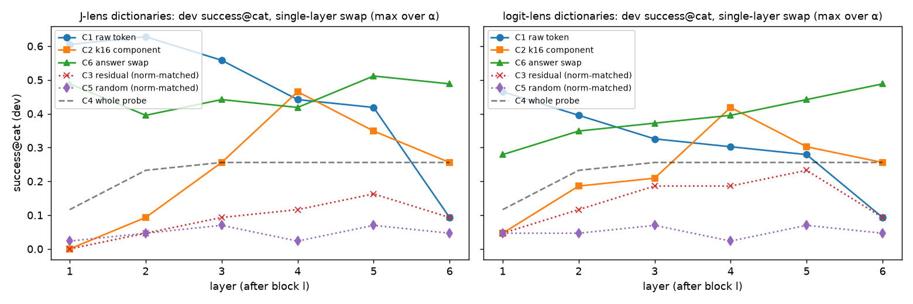
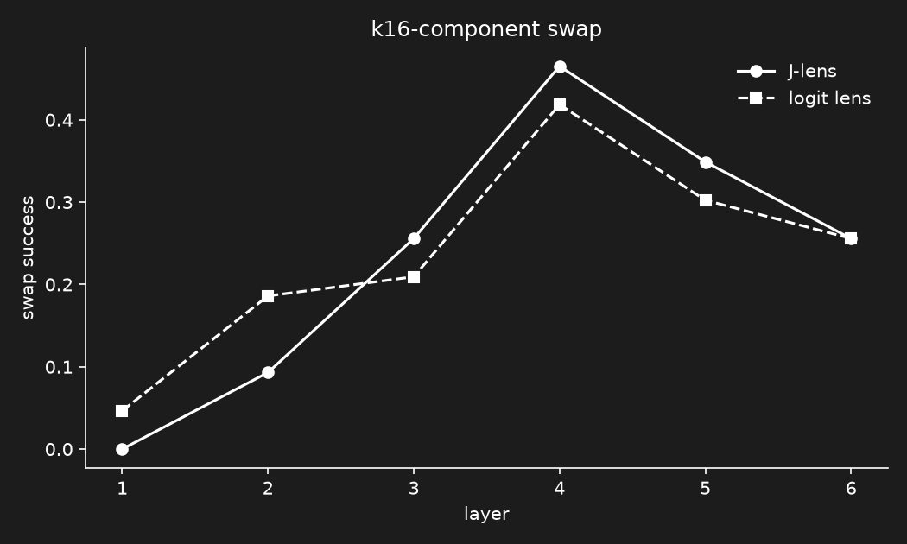
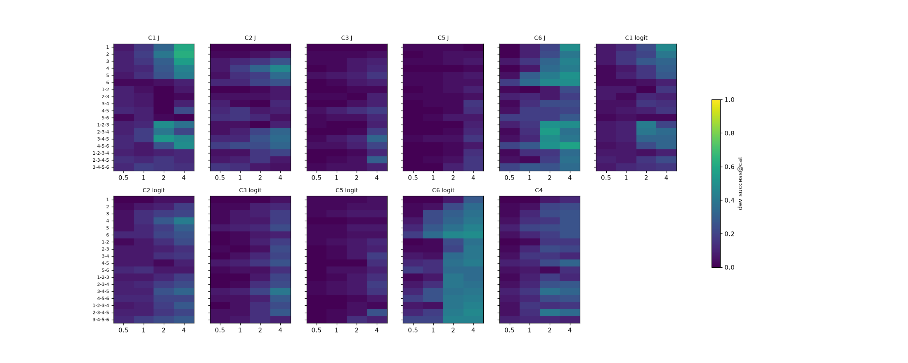
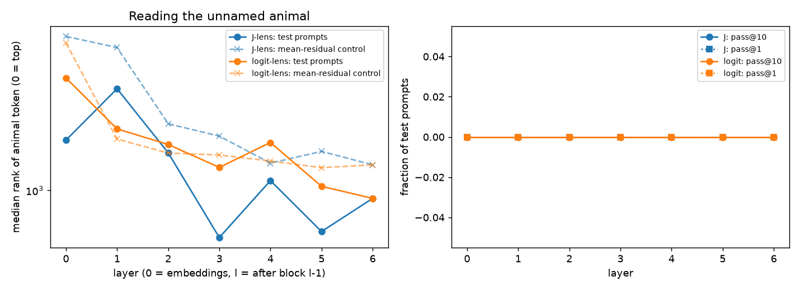
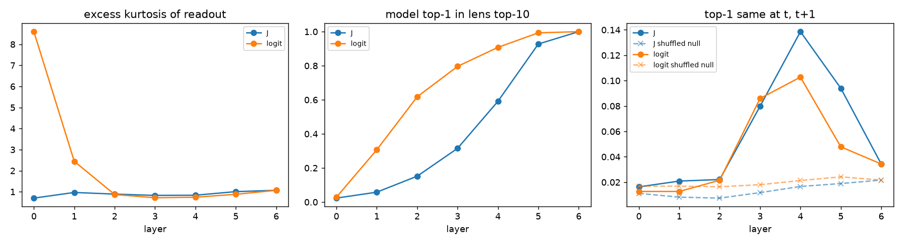

# Подмена невысказанного концепта в TinyStories-GPT: J-lens против logit lens (k=16)

## Коротко

- **H1 — подтверждена.** Подмена по k16-компоненте из словаря J-lens срабатывает чаще, чем из словаря logit lens: success@cat 47.1% против 36.3% (McNemar p = 0.026; с учётом того, что испытания сгруппированы по промптам, p* = 0.014).
- **H2 — для J подтверждена, для logit не подтверждена.** J: k16-компонента 47.1% против остатка 33.3% (p = 0.019, но кластерный бутстрап p* = 0.055 — на грани); logit: 36.3% против 36.3%, разницы нет.
- **H3 — не подтверждена.** C2 сильно лучше случайного контроля (p < 1e-6 для обеих линз), но сам случайный контроль не ≈0: C5 = 10/102 = 9.8%, 95% CI [5.4%, 17.1%] при заранее заданном пороге < 10%. Сильная случайная правка сбивает модель с исходного ответа, и цель иногда угадывается случайно (избирательность C5 ≈ 1/5, см. §7).
- **H4 — для J не подтверждена, для logit подтверждена.** Пик эффекта подмены концепта на одиночном слое раньше, чем у answer swap, в обеих линзах (J: C1 слой 2, C2 слой 4, C6 слой 5; logit: C1 слой 1, C2 слой 4, C6 слой 6), но для J это незначимо на 43 dev-испытаниях (бутстрап p = 0.35 и 0.44).
- **Главная оговорка.** Модель вообще не произносит звук: ни на одном из 30 отобранных промптов первый токен звука не стоит на 1-м месте (медианная вероятность 1.7%). success@cat меряет только порядок среди шести маловероятных звуков. По реальному ответу (success@top1) подмена концепта почти ничего не меняет: C1/C2 — 0%–1%, тогда как answer swap (C6, J) — 71%.
- **Чтение (этап 4) — нулевой результат.** Токен животного на последней позиции не попадает в top-16 ни на одном слое ни в одной из линз (pass@16 = 0); медианный ранг ~700–2000 из 4096.
- **Маленькая выборка.** Из 60 звуковых промптов чистый фильтр прошли 30; у frog — 0, поэтому frog бывает только целью. Испытаний: dev 43, test 102 из 21 test-промптов. α=4 (максимум сетки) выбран почти везде.

## 1. Модель, данные, испытания

- Модель: `src/exp-data/tiny_stories_baseline.pth` — GPT-декодер, 6 блоков, d_model=512, 8 голов, MLP 2048, синусоидальные позиции, связанные эмбеддинги/unembedding, финальный LayerNorm `ln_f`; byte-level BPE на 4096 токенов; 10 эпох на TinyStories, вход `<bos> история <eos>`. Наш val loss на TinyStories validation: 1.00 нат/токен. Токенизатор переписан без библиотеки `tokenizers` и сверен с ней: 0 расхождений на всех 21 990 val-текстах.
- Слои: слой l = residual после блока l (1..6); слой 6 = h_final (до `ln_f`); слой 0 = эмбеддинги.
- J-lens: первые 1000 историй TinyStories validation (≤128 токенов), среднее ∂h_final,t'/∂h_l,t по всем парам t'≥t. Сходимость cos(J_200, J_1000) по слоям 0..6: 0.9958, 0.9958, 0.9961, 0.9965, 0.9975, 0.9989, 1.0000. На слое 6 J = 2/(L+1)·I ровно (масштаб не важен — `ln_f` и нормировка его убирают), cos(J, I) = 1; readout logit lens на слое 6 совпадает с логитами модели (max |Δ| = 0). Подгонка: 1000 историй за 358 с на A40 (100 историй на CPU — 87 мин).
- Проверка перебором (`check_jlens.py`): суммы Якобианов совпадают с `torch.func.jacrev` на всех слоях (max |Δ| ≤ 1.5e-4 при масштабе 30–70), элементы с t'<t ровно 0; J по одним и тем же 100 текстам на CPU и GPU совпадает до 7e-7.

**Этап 1 — 5 «названных» шаблонов на животное, log-prob ответа целиком, 4 варианта написания:**

| животное | золотой ответ | токены | побед | оставлено |
|---|---|---|---|---|
| cat | `Meow` | Me · ow | 5/5 | да |
| dog | `Woof` | W · oof | 5/5 | да |
| cow | `Moo` | M · oo | 5/5 | да |
| duck | `Quack` | Q · u · ack | 4/5 | да |
| sheep | `Baa` | B · a · a | 3/5 | нет |
| pig | `Oink` | O · ink | 0/5 | нет |
| frog | `Ribbit` | R · i · bbit | 5/5 | да |
| lion | `Roar` | R · o · ar | 5/5 | да |
| owl | `Hoot` | H · oot | 3/5 | нет |
| bee | `Buzz` | B · u · zz | 3/5 | нет |
| horse | `Neigh` | N · e · igh | 0/5 | нет |
| snake | `Hiss` | H · iss | 0/5 | нет |

Оставлены: cat, dog, cow, duck, frog, lion. Кандидаты категории во всех метриках: `Meow`, `Woof`, `Moo`, `Quack`, `Ribbit`, `Roar`. У `Ribbit` и `Roar` общий первый токен `R`, поэтому пары frog→lion и lion→frog исключены из всех условий.

**Этап 2 — данные.** По 20 описаний на животное вручную (10 probe с концовками `It liked to eat` / `It lived in a`, 10 test с концовкой `Every morning it said, "`). Автопроверка: ни названий, ни детёнышей, ни звуков ни одного из 12 животных-кандидатов (0 вхождений). Фильтр чистой моделью:

| животное | звуковых промптов | чистая модель выбирает золотой | dev | test |
|---|---|---|---|---|
| cat | 10 | 8 | 2 | 6 |
| dog | 10 | 4 | 1 | 3 |
| cow | 10 | 7 | 2 | 5 |
| duck | 10 | 6 | 2 | 4 |
| frog | 10 | 0 | 0 | 0 |
| lion | 10 | 5 | 2 | 3 |

Испытание = (промпт источника s, цель t≠s): **dev 43, test 102**. Чистый success@cat = 0 по построению (0.00/0.00). Сетка dev: 18 полос (6 одиночных слоёв + окна 2–4) × α ∈ {0.5, 1, 2, 4}; лучшая (полоса, α) для каждой пары (условие, линза) — по success@cat на dev, при равенстве — по среднему отрыву log-prob цели. C3: масштаб подбирается по каждому испытанию (метод секущих), чтобы средняя ‖Δh‖ совпадала с C2 (отношение 1.00±0.01). C5: случайное направление на каждой позиции и слое с ‖Δh‖ из прогона C2 того же испытания.

## 2. Результаты на test (настройки выбраны на dev)

success@cat — ответ цели имеет наибольший полный log-prob среди 6 кандидатов; success@top1 — первый токен ответа цели является top-1 по всему словарю. 95% CI Вильсона; испытания с общим промптом зависимы, поэтому интервалы оптимистичны (кластерный бутстрап — в §7).

| условие | J: полоса, α | J success@cat | J success@top1 | logit: полоса, α | logit success@cat | logit success@top1 |
|---|---|---|---|---|---|---|
| C1 токен животного | 2, 4 | 0.529 [0.433, 0.623] (54/102) | 0.000 [0.000, 0.036] (0/102) | 1, 4 | 0.422 [0.330, 0.519] (43/102) | 0.010 [0.002, 0.053] (1/102) |
| C2 k16-компонента | 4, 4 | 0.471 [0.377, 0.567] (48/102) | 0.010 [0.002, 0.053] (1/102) | 4, 4 | 0.363 [0.276, 0.459] (37/102) | 0.010 [0.002, 0.053] (1/102) |
| C3 остаток (норма как у C2) | 3-4-5, 4 | 0.333 [0.249, 0.429] (34/102) | 0.078 [0.040, 0.147] (8/102) | 3-4-5, 4 | 0.363 [0.276, 0.459] (37/102) | 0.000 [0.000, 0.036] (0/102) |
| C4 проба целиком | 2-3-4-5, 2 | 0.363 [0.276, 0.459] (37/102) | 0.049 [0.021, 0.110] (5/102) | (то же, что J) |  |  |
| C5 случайный (норма как у C2) | 2-3-4-5, 4 | 0.098 [0.054, 0.171] (10/102) | 0.000 [0.000, 0.036] (0/102) | 2-3-4-5, 4 | 0.098 [0.054, 0.171] (10/102) | 0.000 [0.000, 0.036] (0/102) |
| C6 answer swap | 4-5-6, 4 | 0.569 [0.472, 0.661] (58/102) | 0.706 [0.611, 0.786] (72/102) | 6, 4 | 0.510 [0.414, 0.605] (52/102) | 0.510 [0.414, 0.605] (52/102) |

## 3. Гипотезы

Правила решения зафиксированы в `report.py` до просмотра результатов подмены: H1–H3 — точный односторонний тест Макнемара на парных test-испытаниях (α = 0.05); «C5 ≈ 0» — верхняя граница 95% CI Вильсона < 0.10; H4 — пик на dev-сетке одиночных слоёв (максимум по α), C1/C2 раньше C6 и односторонний бутстрап по dev-испытаниям p < 0.05.

- **H1** success@cat(J,C2) > success@cat(logit,C2): 0.471 против 0.363; несовпадающих пар 19/8, p = 0.0261 → **подтверждена**.
- **H2 (J)** C2 > C3: 0.471 против 0.333; несовпадающих 27/13, p = 0.0192 → **подтверждена**.
- **H2 (logit)** C2 > C3: 0.363 против 0.363; несовпадающих 18/18, p = 0.566 → **не подтверждена**.
- **H3 (J)** C2 > C5 и C5 ≈ 0: 0.471 против 0.098; несовпадающих 41/3, p = 8.09e-10; C5 = 10/102, 95% CI [0.054, 0.171] → C5≈0: нет → **не подтверждена**.
- **H3 (logit)** C2 > C5 и C5 ≈ 0: 0.363 против 0.098; несовпадающих 30/3, p = 7.01e-07; C5 = 10/102, 95% CI [0.054, 0.171] → C5≈0: нет → **не подтверждена**.
- **H4 (J, C1 против C6)** пик C1 — слой 2 (dev success@cat 0.628), C6 — слой 5 (0.512); бутстрап p = P*(пик C1 ≥ пик C6) = 0.345 → **не подтверждена**.
- **H4 (J, C2 против C6)** пик C2 — слой 4 (dev success@cat 0.465), C6 — слой 5 (0.512); бутстрап p = P*(пик C2 ≥ пик C6) = 0.442 → **не подтверждена**.
- **H4 (logit, C1 против C6)** пик C1 — слой 1 (dev success@cat 0.465), C6 — слой 6 (0.488); бутстрап p = P*(пик C1 ≥ пик C6) = 0.000 → **подтверждена**.
- **H4 (logit, C2 против C6)** пик C2 — слой 4 (dev success@cat 0.419), C6 — слой 6 (0.488); бутстрап p = P*(пик C2 ≥ пик C6) = 0.049 → **подтверждена**.

## 4. Графики

Успех подмены по одиночным слоям (dev, максимум по α) — C1, C2, C6 и контроли, обе линзы:



C2 для двух словарей на одном графике (dev по слоям с 95% CI; ромбы — test на выбранной настройке):



Вся dev-сетка (строки — полосы, столбцы — α):



### Этап 4: чтение

Медианный ранг токена ` <животное>` (из 4096) на последней позиции test-промптов; пунктир — тот же токен в readout среднего по корпусу residual (контроль частотного перекоса):



| линза | медианный ранг, слои 0..6 | контроль (средний residual) | pass@1/5/10/16 минимального ранга по слоям |
|---|---|---|---|
| J | 1474, 2191, 1336, 695, 1078, 728, 940 | 3281, 3010, 1672, 1520, 1234, 1351, 1218 | 0.00 / 0.00 / 0.00 / 0.00 |
| logit | 2381, 1607, 1425, 1194, 1447, 1032, 940 | 3120, 1486, 1334, 1314, 1254, 1192, 1217 | 0.00 / 0.00 / 0.00 / 0.00 |

Минимальный ранг по слоям для каждого test-промпта — J: [288, 407, 271, 185, 388, 307, 271, 283, 403, 441, 337, 884, 637, 757, 728, 1326, 1177, 799, 549, 308, 336]; logit: [518, 617, 489, 333, 617, 504, 294, 159, 236, 589, 369, 940, 923, 898, 1157, 1477, 1584, 1002, 1222, 581, 631].

Метрики §4.1 на 200 отложенных историях validation (позиции 1..127): excess kurtosis readout, доля позиций, где top-1 модели входит в top-10 линзы, и доля соседних позиций с одинаковым top-1 линзы против перемешанного нуля:



| линза | метрика | слой 0 | 1 | 2 | 3 | 4 | 5 | 6 |
|---|---|---|---|---|---|---|---|---|
| J | excess kurtosis | 0.698 | 0.967 | 0.888 | 0.827 | 0.836 | 1.006 | 1.069 |
| J | top-1 модели ∈ top-10 линзы | 0.023 | 0.058 | 0.152 | 0.315 | 0.591 | 0.927 | 1.000 |
| J | автокорр. top-1 (t, t+1) | 0.016 | 0.021 | 0.022 | 0.080 | 0.139 | 0.094 | 0.034 |
| J | … перемешанный ноль | 0.011 | 0.008 | 0.007 | 0.012 | 0.017 | 0.019 | 0.022 |
| logit | excess kurtosis | 8.601 | 2.444 | 0.869 | 0.714 | 0.740 | 0.879 | 1.069 |
| logit | top-1 модели ∈ top-10 линзы | 0.028 | 0.306 | 0.617 | 0.796 | 0.908 | 0.993 | 1.000 |
| logit | автокорр. top-1 (t, t+1) | 0.013 | 0.013 | 0.022 | 0.086 | 0.103 | 0.048 | 0.034 |
| logit | … перемешанный ноль | 0.017 | 0.017 | 0.016 | 0.018 | 0.021 | 0.024 | 0.022 |

J-lens усредняет влияние на все будущие позиции t'≥t, поэтому хуже logit lens предсказывает *следующий* токен (top-10 ∋ top-1 ниже на всех слоях 0–5), но даёт более устойчивый по позициям top-1 на слоях 4–5 (автокорреляция выше, чем у logit lens и у перемешанного нуля).

## 5. k=16 компоненты на выбранном слое

Проба p_X = средний residual на последнем токене 10 probe-промптов животного минус среднее по всем животным; неотрицательный OMP по 16 атомам единичной длины. Слой — первый слой полосы, выбранной на dev для C2 этой линзы. Доля объяснённой дисперсии = 1 − ‖r‖²/‖p‖².

**J-lens, слой 4**

| животное | доля дисп. | 16 токенов (коэффициент) |
|---|---|---|
| cat | 0.060 | `teddy` 1.50, `kitten` 0.83, `press` 0.79, `love` 0.69, `stairs` 0.67, `tiny` 0.66, `Amy` 0.64, `fold` 0.54, `drawer` 0.53, `owner` 0.53, `button` 0.51, `plate` 0.50, `bowl` 0.38, `Whenever` 0.38, `giggle` 0.37, `lamp` 0.34 |
| dog | 0.059 | `puppy` 1.04, `leash` 0.81, `roll` 0.68, `love` 0.63, `collar` 0.60, `car` 0.59, `loyal` 0.59, `play` 0.57, `di` 0.56, `helping` 0.52, `3` 0.48, `Spot` 0.48, `exp` 0.45, `itself` 0.43, `Whenever` 0.36, `av` 0.30 |
| cow | 0.143 | `Mandy` 1.95, `knife` 1.76, `igh` 1.66, `pig` 1.45, `field` 1.34, `bull` 1.17, `cows` 1.11, `must` 1.06, `eer` 0.70, `uffy` 0.66, `horse` 0.63, `imal` 0.56, `he` 0.55, `horn` 0.52, `mean` 0.48, `melt` 0.48 |
| duck | 0.128 | `nest` 3.22, `sail` 1.99, `branch` 1.67, `chir` 1.16, `per` 0.96, `bread` 0.90, `poem` 0.90, `whistle` 0.78, `feather` 0.72, `pilot` 0.70, `soar` 0.68, `toast` 0.61, `cked` 0.51, `worm` 0.49, `pigeon` 0.46, `ell` 0.42 |
| frog | 0.096 | `mushroom` 1.38, `icy` 0.85, `crawled` 0.75, `orrow` 0.66, `min` 0.64, `mud` 0.58, `een` 0.57, `monster` 0.57, `cute` 0.53, `dry` 0.53, `bounce` 0.52, `xt` 0.48, `pirate` 0.45, `change` 0.44, `glue` 0.43, `gasped` 0.40 |
| lion | 0.111 | `lion` 1.42, `bear` 1.23, `ice` 1.06, `gun` 1.03, `iced` 1.02, `lot` 0.98, `dangerous` 0.90, `tri` 0.88, `yard` 0.78, `Give` 0.78, `mean` 0.71, `crocodile` 0.70, `zebra` 0.69, `meat` 0.62, `print` 0.58, `money` 0.28 |

**logit-lens, слой 4**

| животное | доля дисп. | 16 токенов (коэффициент) |
|---|---|---|
| cat | 0.034 | `teddy` 0.99, `stairs` 0.91, `Amy` 0.74, `ax` 0.31, `Lily` 0.30, `bby` 0.29, `puppy` 0.28, `lease` 0.28, `Sarah` 0.27, `into` 0.23, `three` 0.23, `bug` 0.21, `ex` 0.15, `in` 0.10, `toy` 0.10, `love` 0.09 |
| dog | 0.053 | `Spot` 0.94, `puppy` 0.93, `car` 0.85, `ax` 0.78, `cks` 0.53, `in` 0.47, `loyal` 0.46, `ustr` 0.45, `uddy` 0.45, `new` 0.39, `it` 0.33, `f` 0.17, `'` 0.17, `Grandma` 0.12, `as` 0.09, `et` 0.07 |
| cow | 0.058 | `field` 1.44, `and` 0.99, `animals` 0.87, `horn` 0.69, `pig` 0.68, `tra` 0.60, `thing` 0.45, `mean` 0.44, `bull` 0.38, `must` 0.33, `œYou` 0.32, `igh` 0.28, `horse` 0.25, `aul` 0.25, `te` 0.18, `ump` 0.13 |
| duck | 0.051 | `nest` 3.22, `bird` 1.45, `my` 0.72, `ch` 0.68, `branch` 0.45, `an` 0.34, `twig` 0.32, `on` 0.31, `yellow` 0.27, `blue` 0.22, `l` 0.18, `s` 0.15, `ad` 0.12, `feathers` 0.12, `sail` 0.04, `soar` 0.04 |
| frog | 0.051 | `mushroom` 1.16, `p` 0.43, `of` 0.38, `ice` 0.37, `close` 0.34, `icy` 0.34, `stones` 0.30, `crawled` 0.28, `frog` 0.28, `N` 0.24, `rocks` 0.22, `illy` 0.19, `min` 0.19, `less` 0.16, `dry` 0.14, `skin` 0.13 |
| lion | 0.050 | `lion` 1.08, `ice` 0.87, `Wow` 0.65, `bear` 0.63, `ome` 0.63, `bad` 0.56, `mean` 0.44, `Jo` 0.38, `run` 0.36, `and` 0.29, `œYou` 0.26, `forest` 0.26, `�` 0.25, `hunt` 0.24, `animals` 0.22, `J` 0.22 |

Доля дисперсии пробы, объяснённая c_X, по слоям 1..6:

| линза | животное | L1 | L2 | L3 | L4 | L5 | L6 |
|---|---|---|---|---|---|---|---|
| J | cat | 0.03 | 0.04 | 0.05 | 0.06 | 0.09 | 0.07 |
| J | dog | 0.04 | 0.04 | 0.05 | 0.06 | 0.11 | 0.09 |
| J | cow | 0.03 | 0.06 | 0.08 | 0.14 | 0.17 | 0.08 |
| J | duck | 0.01 | 0.06 | 0.12 | 0.13 | 0.14 | 0.08 |
| J | frog | 0.03 | 0.03 | 0.07 | 0.10 | 0.10 | 0.07 |
| J | lion | 0.04 | 0.05 | 0.11 | 0.11 | 0.14 | 0.09 |
| logit | cat | 0.04 | 0.06 | 0.05 | 0.03 | 0.06 | 0.07 |
| logit | dog | 0.04 | 0.06 | 0.06 | 0.05 | 0.08 | 0.09 |
| logit | cow | 0.01 | 0.02 | 0.03 | 0.06 | 0.08 | 0.08 |
| logit | duck | 0.02 | 0.03 | 0.06 | 0.05 | 0.06 | 0.08 |
| logit | frog | 0.07 | 0.04 | 0.04 | 0.05 | 0.05 | 0.07 |
| logit | lion | 0.06 | 0.03 | 0.04 | 0.05 | 0.05 | 0.09 |

## 6. Примеры (C2, J-lens, band 4, α=4, test)

Жадное продолжение на 8 токенов (правка только на позициях промпта); «выбор» — argmax среди 6 звуков-кандидатов; p(t) — вероятность полного ответа цели. По 5 испытаний, по кругу по животным-источникам.

**Удачные**

| s → t | промпт | до: выбор / продолжение | после: выбор / продолжение | p(t) до → после |
|---|---|---|---|---|
| cat → dog | Once upon a time, a small pet with soft paws lived with an old lady. She gave it a bowl of milk every day. Every morning it said, " | cat / `Thank you for the milk!"\n\n` | dog / `Thank you for the milk!"\n\n` | 2.5e-03 → 8.8e-03 |
| dog → cat | There was a happy pet that licked Sam's face and jumped on him. It had a long pink tongue. Every morning it said, " | dog / `Good morning, Sam!" Sam was so` | cat / `Good morning, Sam!" Sam smiled and` | 2.4e-02 → 2.2e-02 |
| cow → cat | There was a large farm animal that stood still in the barn while the farmer milked it. Every morning it said, " | cow / `Good morning, farmer!" The farmer was` | cat / `I'm so happy to be here!"` | 1.8e-03 → 9.4e-03 |
| duck → cat | Lily threw bread into the pond, and a hungry bird paddled over to get it. Every morning it said, " | duck / `Thank you for the bread, Lily!"` | cat / `Please, can I have some of your` | 2.4e-03 → 6.2e-03 |
| lion → cat | Once upon a time, there was a big wild animal with a golden mane. It was the king of the jungle. Every morning it said, " | lion / `I am so big and strong!"\n` | cat / `Good morning, little one!"\n\n` | 5.0e-04 → 1.4e-03 |

**Неудачные**

| s → t | промпт | до: выбор / продолжение | после: выбор / продолжение | p(t) до → после |
|---|---|---|---|---|
| cat → duck | Once upon a time, a small pet with soft paws lived with an old lady. She gave it a bowl of milk every day. Every morning it said, " | cat / `Thank you for the milk!"\n\n` | cow / `Thank you for the milk!"\n\n` | 5.8e-05 → 1.0e-03 |
| dog → duck | There was a happy pet that licked Sam's face and jumped on him. It had a long pink tongue. Every morning it said, " | dog / `Good morning, Sam!" Sam was so` | cow / `Good morning, Sam!" Sam was so` | 4.1e-05 → 1.2e-03 |
| cow → dog | There was a large farm animal that stood still in the barn while the farmer milked it. Every morning it said, " | cow / `Good morning, farmer!" The farmer was` | cat / `I'm so happy to be here!"` | 3.3e-04 → 3.2e-03 |
| duck → frog | Lily threw bread into the pond, and a hungry bird paddled over to get it. Every morning it said, " | duck / `Thank you for the bread, Lily!"` | duck / `Please, can I have some of your` | 2.5e-04 → 3.1e-04 |
| lion → cat | There was a proud animal that wore a crown and ruled over the whole jungle. Every morning it said, " | lion / `I am the king of the jungle!"` | lion / `I am the proudest person in the` | 6.4e-04 → 7.8e-04 |

## 7. Разведочный анализ (post hoc, в проверке H1–H4 не используется)

Сбой = доля испытаний, где выбор ушёл с источника; избирательность = P(выбор = t | выбор ≠ s), случайный уровень ≈ 1/5.

| условие | линза | success@cat | сбой | избирательность | средний отрыв цели (нат) |
|---|---|---|---|---|---|
| C1 токен животного | J | 0.529 | 0.725 | 0.730 (n=74) | 0.23 |
| C1 токен животного | logit | 0.422 | 0.500 | 0.843 (n=51) | -0.55 |
| C2 k16-компонента | J | 0.471 | 0.745 | 0.632 (n=76) | -0.47 |
| C2 k16-компонента | logit | 0.363 | 0.529 | 0.685 (n=54) | -1.80 |
| C3 остаток (норма как у C2) | J | 0.333 | 0.471 | 0.708 (n=48) | -3.96 |
| C3 остаток (норма как у C2) | logit | 0.363 | 0.520 | 0.698 (n=53) | -3.75 |
| C4 проба целиком | — | 0.363 | 0.490 | 0.740 (n=50) | -3.66 |
| C5 случайный (норма как у C2) | J | 0.098 | 0.598 | 0.164 (n=61) | -3.34 |
| C5 случайный (норма как у C2) | logit | 0.098 | 0.588 | 0.167 (n=60) | -3.49 |
| C6 answer swap | J | 0.569 | 0.725 | 0.784 (n=74) | -4.21 |
| C6 answer swap | logit | 0.510 | 0.569 | 0.897 (n=58) | -2.48 |

Все неслучайные условия направляют ответ именно в цель (избирательность 0.63–0.90), а случайный контроль — нет (≈0.16). То есть успех C1–C4/C6 — не только «сбить модель», хотя частично и это.

Зависимость испытаний: 102 test-испытаний построены из 21 промптов. Кластерный бутстрап по промптам (5000 повторов) для разностей success@cat; p* = P*(разность ≤ 0):

| сравнение | разность | 95% CI | p* |
|---|---|---|---|
| H1: J C2 − logit C2 | +0.108 | [+0.019, +0.198] | 0.014 |
| H2: J C2 − J C3 | +0.137 | [-0.020, +0.307] | 0.055 |
| H2: logit C2 − logit C3 | +0.000 | [-0.137, +0.158] | 0.535 |
| H3: J C2 − J C5 | +0.373 | [+0.230, +0.519] | 0.000 |
| H3: logit C2 − logit C5 | +0.265 | [+0.143, +0.390] | 0.000 |

## 8. Воспроизведение

```
cd experiments/swap_tinystories
python stage1_capabilities.py      # этап 1
python stage2_data.py              # этап 2 → data/*.json
python fit_jlens.py --n 1000 --chunk 512 --checkpoints 100,200,1000   # этап 3 (GPU: ~6 мин)
python check_jlens.py              # проверки J
python stage4_read.py              # этап 4
python stage5_probes.py            # этап 5
python swap.py cuda                # этапы 6–8 (L4: ~5 мин)
python examples.py && python report.py
```
